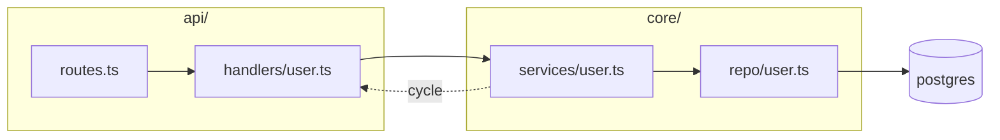

# Map

Scope: **$ARGUMENTS**

Produce a diagram that shows the real structure, derived from imports and call sites — not
an idealised architecture diagram of how the system was supposed to look. The gap between
those two is usually the most interesting thing on the page.

## 1. Bound the scope first

A diagram of an entire repo is a hairball nobody reads. Pick one of:

- **A subsystem** — one directory and its immediate dependencies.
- **A flow** — one request, job, or user action traced end to end.
- **A layer boundary** — what crosses between two modules, and in which direction.

If the scope given is broader than that, narrow it and say which slice you drew.

## 2. Derive the edges from the code

Read the imports. Do not infer structure from directory names — the two disagree more often
than not, and the disagreement is the finding.

```
git ls-files '<scope>/**'
```

Then grep the import statements in that set and build the edge list from what you find.
For a flow, trace one concrete path by opening each hop rather than guessing the next one.

Every arrow in the final diagram must correspond to an import or a call you actually read.

## 3. Choose the diagram that fits

| Question | Diagram |
| --- | --- |
| What depends on what? | `graph LR` — module dependency |
| What happens when X is called? | `sequenceDiagram` — the hops, in order |
| What states can this be in? | `stateDiagram-v2` |
| What is the shape of the data? | `erDiagram` or `classDiagram` |

Pick one. Two diagrams answering the same question is worse than one.

## 4. Draw it



Rules that keep it readable:

- **Twelve nodes maximum.** Past that, collapse a group into one node and diagram it
  separately if it matters.
- **Label nodes with real file or module names**, so a reader can open them.
- **Direction is meaning.** Keep dependency arrows pointing one way; an arrow going
  backwards should be visually obvious, because it is usually a cycle or a layering
  violation.
- **Use `subgraph` for the boundaries that actually exist** — a package, a layer, a
  deployment unit.
- **Mark the anomalies**: dotted lines for cycles, a distinct shape for external services,
  a note on anything that surprised you.

## 5. Write the reading

A diagram without prose is half a deliverable. Follow it with:

- **How to read it** — one or two sentences on what the boxes and arrows mean here.
- **What stands out** — cycles, a module everything depends on, a layer that gets bypassed,
  a component with no inbound edges (possibly dead).
- **What is not shown** — the scope you cut, so nobody mistakes the map for the territory.

## Output

Print the diagram in the reply. Write it to a file only if the user asks or if it belongs
in the repo's docs — in which case match the existing docs conventions and location.

Mermaid renders directly in Claude Code, GitHub, and most Markdown viewers, which is why it
beats an image here: it stays diffable and editable.

## Do not

- Draw an arrow you did not verify in the code.
- Include every file. A map at 1:1 scale is not a map.
- Redraw a diagram the repo already has without saying how yours differs from it.
